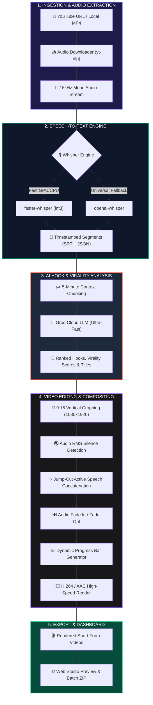

<div align="center">

# 🎬 CLIPER AI
### Autonomous Viral Shorts & Video Clipping Studio

<p align="center">
  <a href="https://github.com/dhruv-lx/video-clipper">
    
  </a>
</p>

[](https://github.com/dhruv-lx/video-clipper/actions)
[](https://www.python.org/)
[](https://streamlit.io/)
[](https://groq.com/)
[](https://github.com/openai/whisper)
[](https://ffmpeg.org/)
[](https://opensource.org/licenses/MIT)

<br/>

**Transform 2-hour YouTube podcasts, technical tutorials, and interviews into high-retention 9:16 vertical shorts, reels, and TikToks with AI-powered hook detection, automatic silence removal, and dynamic progress bars.**

<p align="center">
  <a href="#-key-features"><b>Explore Features</b></a> •
  <a href="#-web-studio-walkthrough"><b>Web Studio UI</b></a> •
  <a href="#-quick-start"><b>Quick Start</b></a> •
  <a href="#-architecture"><b>Architecture</b></a> •
  <a href="#-cli-usage"><b>CLI Automation</b></a> •
  <a href="#-comparison"><b>Why Cliper?</b></a>
</p>

</div>

---

## ⚡ What is Cliper AI?

Editing long-form videos into short-form content manually takes hours of tedious work: scrubbing through timelines, finding hooks, manually cutting silence, cropping to vertical 9:16, and rendering.

**Cliper AI automates the entire lifecycle in one unified pipeline:**

```
[ 🎥 Paste YouTube Link / Upload Video ]
                   │
                   ▼
  1. 🎙️ Whisper Multi-Model Speech Recognition (Fast GPU/CPU STT)
                   │
                   ▼
  2. 🧠 Groq LLM Hook Intelligence (Finds Viral Punchlines & Categorizes)
                   │
                   ▼
  3. 🔇 RMS Audio Silence Detection & Jump-Cutter (Kills Boring Pauses)
                   │
                   ▼
  4. 📐 9:16 Smart Vertical Re-Framer & Bottom Progress Bar Overlay
                   │
                   ▼
[ 🚀 Ready-to-Post 1080x1920 MP4 Shorts + Batch ZIP Download ]
```

---

## ✨ Key Features

<table>
  <tr>
    <td width="50%">
      <h3>🧠 AI Hook Detection & Scoring</h3>
      Scans the full audio transcript with <b>Groq LLMs</b> to identify standalone, high-impact moments. Assigns a <b>1-100 Virality Score</b> and categorizes clips into <i>Contrarian, Insight, Story, Tutorial, or Humor</i>.
    </td>
    <td width="50%">
      <h3>⚡ Automatic Silence Jump-Cuts</h3>
      Uses mathematical <b>RMS audio envelope analysis</b> to detect dead silence, breaths, and pauses, automatically slicing them out to maximize retention on TikTok and Reels.
    </td>
  </tr>
  <tr>
    <td width="50%">
      <h3>📱 9:16 Vertical Video Re-Framing</h3>
      Intelligently converts widescreen 16:9 videos into crystal-clear <b>1080x1920 vertical shorts</b> with customizable center bias and speaker alignment.
    </td>
    <td width="50%">
      <h3>📊 Animated Bottom Progress Bar</h3>
      Renders dynamic, customizable progress bars directly onto the video to boost average watch time and psychological viewer engagement.
    </td>
  </tr>
  <tr>
    <td width="50%">
      <h3>🎨 Modern Dark-Mode Web Studio</h3>
      A next-generation <b>glassmorphic SaaS interface</b> with interactive tabs: Auto-Pilot Extractor, Precision Trimmer, Video Library, Subtitle Search, and API Diagnostics.
    </td>
    <td width="50%">
      <h3>🛡️ Enterprise Security & Privacy</h3>
      Zero hardcoded secrets. Full <code>.env</code> isolation, strict <code>.gitignore</code> rules, and automated CI test verification.
    </td>
  </tr>
</table>

---

## 🖥️ Web Studio Walkthrough

The built-in web studio is designed like a modern SaaS dashboard:

```
┌─────────────────────────────────────────────────────────────────────────────┐
│ 🎬 CLIPER AI STUDIO             [🟢 Groq: Ready]  [🟢 Whisper: Ready]       │
├─────────────────────────────────────────────────────────────────────────────┤
│  [🚀 Auto-Pilot Clipper]  [✂️ Precision Trimmer]  [📁 Library]  [📝 Subtitles] │
├─────────────────────────────────────────────────────────────────────────────┤
│                                                                             │
│  🔗 Video Source: [ https://www.youtube.com/watch?v=...               ]     │
│                                                                             │
│  ⚙️ Min Dur: [ 30s ]    Max Dur: [ 60s ]    Aspect Ratio: [ 9:16 Vertical ] │
│  🎛️ Silence Jump-Cuts: [ON]                Bottom Progress Bar: [ON]        │
│                                                                             │
│                     [ ✨ Launch Autonomous AI Clipper ]                     │
│                                                                             │
│  ─────────────────────────────────────────────────────────────────────────  │
│  🏆 RANKED VIRAL CLIPS DETECTED                                             │
│                                                                             │
│  ┌─────────────────────────┐  ┌──────────────────────────────────────────┐  │
│  │ 🎬 [VIDEO PREVIEW]      │  │ #1 Why 99% Of People Fail At Coding      │  │
│  │                         │  │ 🔥 96% Virality Score   📌 Contrarian    │  │
│  │  1080x1920 Vertical     │  │ ⏱️ 00:01:15 → 00:01:55  (40s duration)    │  │
│  │  Animated Progress Bar  │  │                                          │  │
│  │                         │  │ 💬 "The biggest lie in tech is math..."  │  │
│  │ [⬇️ Download MP4]       │  │                                          │  │
│  └─────────────────────────┘  └──────────────────────────────────────────┘  │
│                                                                             │
│  📦 [Download All as ZIP Archive]                                           │
└─────────────────────────────────────────────────────────────────────────────┘
```

---

## 📊 Comparison: Why Cliper AI?

| Feature | Manual Video Editing | Generic Online Cutters | 🎬 **Cliper AI** |
| :--- | :---: | :---: | :---: |
| **Workflow** | Scrubbing timeline (2+ hrs) | Manual cutting | **Autonomous 1-Click** |
| **AI Hook Detection** | ❌ No | ❌ No | **✅ Groq LLaMA 3.3 / Qwen** |
| **Silence Removal** | Manual razor tool | ⚠️ Clunky | **✅ Automatic RMS Jump-Cuts** |
| **Aspect Framing** | Manual keyframing | Basic stretch | **✅ Dynamic 9:16 Re-Framing** |
| **Animated Progress Bar** | Motion graphics work | ❌ No | **✅ Built-in Overlay** |
| **Speech Subtitles** | Manual typing / SRT | Paid feature | **✅ Whisper Multi-Engine** |
| **Privacy & Cost** | Local / Free | \$30-\$60/mo subscription | **✅ 100% Free & Open Source** |

---

## 🏗️ Architecture & Technical Pipeline



---

## ⚡ Quick Start

### 1. Prerequisites
- **Python 3.10 to 3.13** installed
- **FFmpeg** installed on your system
- A free **[Groq API Key](https://console.groq.com/keys)**

### 2. Installation

```bash
# 1. Clone the repository
git clone https://github.com/dhruv-lx/video-clipper.git
cd video-clipper

# 2. (Optional) Create virtual environment
python -m venv venv
venv\Scripts\activate       # Windows
# source venv/bin/activate  # macOS / Linux

# 3. Install required packages
pip install -r requirements.txt
```

### 3. Configure API Key
Create your `.env` file from the provided example:
```bash
cp .env.example .env
```
Inside `.env`:
```ini
GROQ_API_KEY=your_groq_api_key_here
WHISPER_MODEL=base
```

---

## 🚀 Running the App

### Option A: 1-Click Desktop Launcher (Windows)
Simply double-click **`run_app.bat`** in the project folder.

### Option B: Terminal Command
```bash
streamlit run app.py
```
Opens your browser automatically at `http://localhost:8501`.

---

## 💻 Command Line Interface (CLI)

Prefer working from the terminal or need headless automation? Cliper provides a full CLI:

```bash
# 🌟 Full Autonomous Viral Extraction:
python cli.py auto "https://www.youtube.com/watch?v=VIDEO_ID"

# ⏱️ Precision Manual Segment Cutter:
python cli.py clip "input.mp4" 01:15 01:55 --ratio 9:16 -o viral_clip.mp4

# 🎙️ Extract Audio & Transcribe to SRT Subtitle:
python cli.py transcribe "podcast.mp4" --model base -o transcript.srt

# 🖥️ Launch Web Studio:
python cli.py ui --port 8501
```

---

## 📂 Project Structure

```
video-clipper/
├── .github/workflows/       # Automated CI/CD testing workflow
│   └── ci.yml
├── .env.example             # Clean configuration template
├── .gitignore               # Strict ignore protecting keys, videos, and cache
├── README.md                # Project documentation
├── LICENSE                  # MIT License
├── requirements.txt         # Production dependencies
├── pyproject.toml           # Modern package configuration
├── app.py                   # Streamlit Web Studio application
├── run_app.bat              # 1-Click Windows desktop launcher
├── cli.py                   # Unified CLI tool
│
├── cliper/                  # Core Python Package
│   ├── __init__.py          # Package entry point
│   ├── ai.py                # Groq LLM viral hook detection & scoring
│   ├── audio.py             # Audio downloader & Whisper STT engine
│   ├── config.py            # Settings & .env loader
│   ├── pipeline.py          # Autonomous end-to-end pipeline runner
│   ├── silence.py           # RMS audio analysis & jump-cut generator
│   └── video.py             # MoviePy / FFmpeg 9:16 auto-cropper & progress bar
│
├── scripts/                 # Standalone utility scripts
│   ├── clip_video.py        # Precision manual clipper
│   ├── cut_clips.py         # Batch JSON video cutter
│   └── get_timestamps.py    # AI hook detection to JSON
│
├── examples/                # Sample output data
│   ├── clip_data.json       # Pre-analyzed sample viral hooks
│   └── full_transcript.srt  # Sample subtitle transcript file
│
└── tests/                   # Automated unit test suite
    └── test_cliper.py       # 5/5 Passing unit tests
```

---

## 🧪 Testing

Run the automated test suite with `pytest`:
```bash
python -m pytest tests/
```

All 5 core unit tests verify:
- ✅ Timestamp conversion & normalisation (`HH:MM:SS` ⇄ seconds)
- ✅ Filename sanitization against malicious inputs
- ✅ AI JSON response parser & markdown fencing stripper
- ✅ Overlapping clip deduplication & scoring logic
- ✅ Configuration default validations

---

## 🤝 Contributing

Contributions, issues, and feature requests are welcome!
1. Fork the Project
2. Create your Feature Branch (`git checkout -b feature/CoolFeature`)
3. Commit your Changes (`git commit -m 'feat: Add CoolFeature'`)
4. Push to the Branch (`git push origin feature/CoolFeature`)
5. Open a Pull Request

---

## 📄 License

Distributed under the **MIT License**. See [`LICENSE`](LICENSE) for more information.

---

<div align="center">

Crafted with ❤️ by **[Dhruv](https://github.com/dhruv-lx)**

**If you find Cliper AI useful, consider giving it a ⭐ star on GitHub!**

</div>
