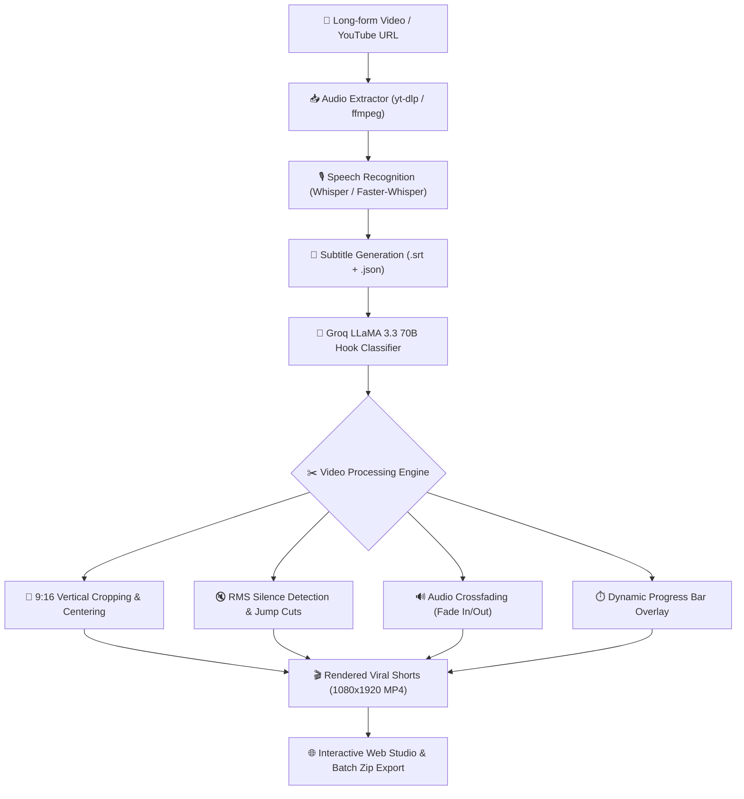

# 🎬 Cliper AI — Autonomous Viral Shorts & Video Clipping Studio

<div align="center">

[](https://www.python.org/)
[](https://streamlit.io/)
[](https://groq.com/)
[](https://github.com/openai/whisper)
[](https://ffmpeg.org/)
[](https://opensource.org/licenses/MIT)

**Turn long-form YouTube videos, podcasts, and recordings into high-converting 9:16 vertical shorts, reels, and TikToks with AI-powered hook detection, automatic silence removal, and retention progress bars.**

[Features](#-key-features) • [Quick Start](#-quick-start) • [Web Studio UI](#-modern-web-studio) • [Architecture](#-architecture--workflow) • [CLI Usage](#-command-line-interface-cli) • [Configuration](#-configuration)

</div>

---

## 🚀 Overview

**Cliper AI** is a production-grade, autonomous content repurposing engine. Rather than spending hours manually scrubbing through 2-hour podcasts or technical tutorials, Cliper AI orchestrates **Whisper Speech-to-Text**, **Groq LLaMA 3.3 70B Intelligence**, and **MoviePy/FFmpeg** to automatically discover the most captivating hooks, strip dead pauses, re-frame to 9:16 vertical format, and generate ready-to-post short-form videos.

Whether you're an editor looking to 10x your output or presenting this in your portfolio, Cliper AI offers both an intuitive **Next-Gen Web Studio** and a robust **Automated CLI pipeline**.

---

## ✨ Key Features

- 🧠 **AI-Powered Hook & Virality Scoring**: Scans video transcripts using **Groq (LLaMA 3.3 70B)** to isolate standalone moments with strong opening hooks, categorized by type (*Contrarian, Insight, Story, Tutorial, Humor*) and rated with a 1-100 Virality Score.
- 🎙️ **Multi-Engine Speech Recognition**: Deep integration with **OpenAI Whisper** and **faster-whisper** with support for multiple model sizes (`tiny`, `base`, `small`, `medium`).
- ⚡ **Smart Silence Removal (Jump Cuts)**: Uses audio RMS envelope analysis to automatically detect and slice out awkward pauses, breaths, and dead air without clipping speech.
- 📱 **Intelligent 9:16 Vertical Re-Framing**: Automatically crops 16:9 widescreen footage into high-definition 1080x1920 vertical format for YouTube Shorts, Instagram Reels, and TikTok.
- 📊 **Animated Bottom Progress Bar**: Generates smooth dynamic progress bars to maximize viewer retention and watch time.
- 🎨 **Modern SaaS Web Studio**: High-end glassmorphic dark UI with live video playback, subtitle explorer, individual clip rendering, and 1-click batch ZIP downloads.
- 💻 **Unified CLI**: Scriptable command-line interface for headless automation, server pipelines, and cron jobs.
- 🛡️ **Zero Secret Leaks**: Built-in `.env` configuration management and strict `.gitignore` rules to keep private API keys secure.

---

## 🏗️ Architecture & Workflow



---

## ⚡ Quick Start

### 1. Prerequisites
- **Python 3.10+** installed
- **FFmpeg** installed and accessible in your system `PATH`
- A free **[Groq API Key](https://console.groq.com/keys)**

### 2. Clone & Install
```bash
# Clone the repository
git clone https://github.com/your-username/cliper.git
cd cliper

# (Optional) Create virtual environment
python -m venv venv
venv\Scripts\activate       # On Windows
# source venv/bin/activate  # On macOS/Linux

# Install all dependencies
pip install -r requirements.txt
```

### 3. Setup Environment Variables
Copy the example environment file and add your Groq API key:
```bash
cp .env.example .env
```
Inside `.env`:
```ini
GROQ_API_KEY=gsk_your_groq_api_key_here
WHISPER_MODEL=base
```

---

## 🖥️ Modern Web Studio

Launch the sleek, dark-themed Web Studio interface with one command (or double-click `run_app.bat` on Windows):

```bash
# Method 1: Using the launcher
run_app.bat

# Method 2: Streamlit directly
streamlit run app.py

# Method 3: Using the CLI
python cli.py ui
```

### Studio Capabilities:
1. **🚀 Auto-Pilot Viral Clipper**: Paste any YouTube link, adjust target duration sliders, and click *Launch Autonomous AI Clipper* to get ranked shorts in minutes.
2. **✂️ Precision Manual Trimmer**: Manually specify exact start/end timestamps (`01:15` → `01:50`) with live duration calculations and custom aspect framing (9:16, 1:1, 16:9).
3. **📁 Clip Library & Exports**: In-browser video player for all rendered shorts, individual MP4 download buttons, and a **Download All as ZIP** batch exporter.
4. **📝 Subtitles & Transcripts**: Search transcript text by keyword with timestamp jumps and download clean `.srt` subtitle files.
5. **⚙️ Studio Settings**: Live Groq API connection test, model selector, and 1-click temporary cache cleaner.

---

## 💻 Command Line Interface (CLI)

Cliper AI includes a versatile CLI for terminal workflows and automated pipelines.

### 1. Full Autonomous Viral Extraction
```bash
# Automatically transcribe, detect hooks, and render 9:16 vertical shorts
python cli.py auto "https://www.youtube.com/watch?v=VIDEO_ID"

# Detect viral hooks and save JSON/SRT without rendering video files
python cli.py auto "https://www.youtube.com/watch?v=VIDEO_ID" --no-render
```

### 2. Precision Manual Segment Cutter
```bash
# Clip a specific timestamp with 9:16 vertical framing and jump cuts
python cli.py clip "https://www.youtube.com/watch?v=VIDEO_ID" 01:30 02:15 -o viral_clip.mp4

# Clip without silence removal or progress bar
python cli.py clip "my_video.mp4" 00:45 01:30 --ratio 16:9 --keep-silence --no-bar
```

### 3. Speech Transcription Only
```bash
# Transcribe any video/audio to standard SRT subtitle file
python cli.py transcribe "podcast.mp4" --model base -o podcast.srt
```

---

## ⚙️ Configuration Reference

All settings can be configured via `.env` or overridden inside the Web Studio:

| Variable | Default | Description |
| :--- | :--- | :--- |
| `GROQ_API_KEY` | `""` | Groq Cloud API key for LLaMA 3.3 70B evaluation |
| `GROQ_MODEL` | `llama-3.3-70b-versatile` | Groq LLM model identifier |
| `WHISPER_MODEL` | `base` | Whisper model size (`tiny`, `base`, `small`, `medium`) |
| `TARGET_WIDTH` | `1080` | Output video width in pixels |
| `TARGET_HEIGHT` | `1920` | Output video height in pixels (9:16 aspect ratio) |
| `REMOVE_SILENCE` | `true` | Enable RMS silence removal and jump cutting |
| `SILENCE_MIN_LEN`| `0.55` | Minimum silence duration (in seconds) to trigger jump cut |
| `SILENCE_THRESH` | `0.03` | Volume threshold relative to peak RMS to classify silence |

---

## 📁 Repository Structure

```
cliper/
├── .env.example            # Sample configuration file
├── .gitignore              # Robust git ignore (protects keys, outputs, and caches)
├── README.md               # Project documentation & showcase
├── requirements.txt        # Production dependency manifest
├── pyproject.toml          # Modern packaging & pytest config
├── app.py                  # Modern Streamlit Web Studio application
├── run_app.bat             # 1-click Windows desktop launcher
├── cli.py                  # Unified command-line interface
│
├── cliper/                 # Core Python engine package
│   ├── __init__.py         # Package entry point
│   ├── config.py           # Configuration loader
│   ├── audio.py            # Audio extractor & Whisper transcription
│   ├── ai.py               # Groq LLM viral hook detection
│   ├── video.py            # MoviePy / FFmpeg video cutter & 9:16 framer
│   ├── silence.py          # RMS audio analysis & jump-cut generator
│   └── pipeline.py         # Autonomous end-to-end pipeline runner
│
├── scripts/                # Standalone automation scripts
│   ├── clip_video.py       # Quick manual precision clipper
│   ├── get_timestamps.py   # AI hook finder to JSON
│   └── cut_clips.py        # Batch JSON cutter & 9:16 framer
│
├── examples/               # Sample outputs & reference files
│   ├── clip_data.json      # Sample AI viral hooks output
│   └── full_transcript.srt # Sample subtitle file
│
└── tests/                  # Automated unit test suite
    └── test_cliper.py      # Unit tests (conversions, parsing, deduplication)
```

---

## 🧪 Testing

Run automated unit tests with `pytest`:
```bash
python -m pytest tests/
```

---

## 🤝 Contributing

Contributions, issues, and feature suggestions are welcome!
1. Fork the Project
2. Create your Feature Branch (`git checkout -b feature/AmazingFeature`)
3. Commit your Changes (`git commit -m 'Add some AmazingFeature'`)
4. Push to the Branch (`git push origin feature/AmazingFeature`)
5. Open a Pull Request

---

## 📄 License

Distributed under the **MIT License**. See `LICENSE` for details.

---

<div align="center">
Built with passion by <b>Dhruv</b> • Star ⭐ this repo if you find it helpful!
</div>

